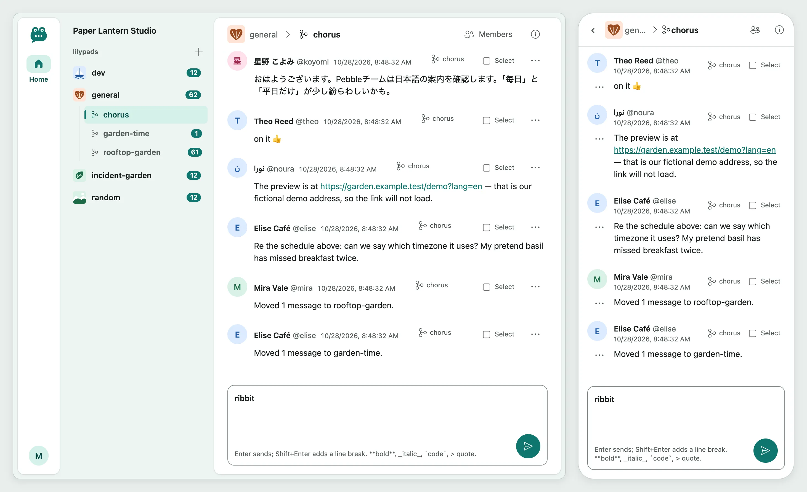

# ribbitto

A self-hostable team chat that is fast, where nothing gets buried, and
with nothing to learn. There is a frog on the logo.

> **Status: early development.** Accounts, channels, topics, real-time
> messages, unread counts, presence and typing indicators work. The MVP is
> complete, including dark mode and mobile layout; there is no release yet. See the
> [roadmap](docs/roadmap.md) and the pinned Status issue.

*The `general` channel with its topics, on desktop and phone.*

## What it will be

What each principle means, and how changes are checked against it, is in
the [vision](docs/vision.md).

- **Fast:** quick to use in the browser and light on a small server, with
  both measured.
- **Nothing gets buried:** topics inside channels, unread state per topic,
  and one view of what was addressed to you.
- **Nothing to learn:** every channel has a default topic, so you talk
  first and branch a conversation into its own topic later.
- Messages arrive in real time, with presence and typing indicators.
- Server-rendered HTML with htmx: one Go binary, with a Go-driven front-end build.
- English and Japanese UI.
- Easy to self-host: a container image and a Compose file with PostgreSQL
  and Caddy.

## Stack

Go, `net/http`, templ, htmx (Server-Sent Events), Tailwind CSS,
PostgreSQL with pgx, sqlc and goose.

## Development

Running it locally for development (`make db-up`, migrations, optional seed data and `make dev`): see [local development](docs/development.md).

### Checks

Pre-PR and CI checks (`make check`, `make prepush` and `make vuln`): see [checks](docs/development.md#checks).

## First-run setup

First-run setup of an instance (`RIBBITTO_SETUP_TOKEN` and `/setup`) and sign-up (`RIBBITTO_SIGNUP`): see [first-run setup](docs/setup-and-backup.md#first-run-setup).

## Restoring a backup

Stop ribbitto, restore the database, then start ribbitto; see [restoring a backup](docs/setup-and-backup.md#restoring-a-backup).

## Documentation

See the [documentation index](docs/README.md) for the full list.

- [Vision](docs/vision.md) — aims and acceptance criteria
- [Roadmap](docs/roadmap.md)
- [Architecture](docs/architecture/README.md) — packages, imports and data flow
- [Domain](docs/domain/README.md) — glossary and index
- [UI](docs/ui.md) — design, tokens
- [Decisions](DECISIONS.md) — what was decided and why
- [AI development workflow](docs/workflow/README.md)

## Contributing

See [`AGENTS.md`](AGENTS.md) for conventions and [`docs/workflow/`](docs/workflow/README.md) for how work flows.
Issues and pull requests are welcome, in English.

## Licence

[MIT](LICENSE)
