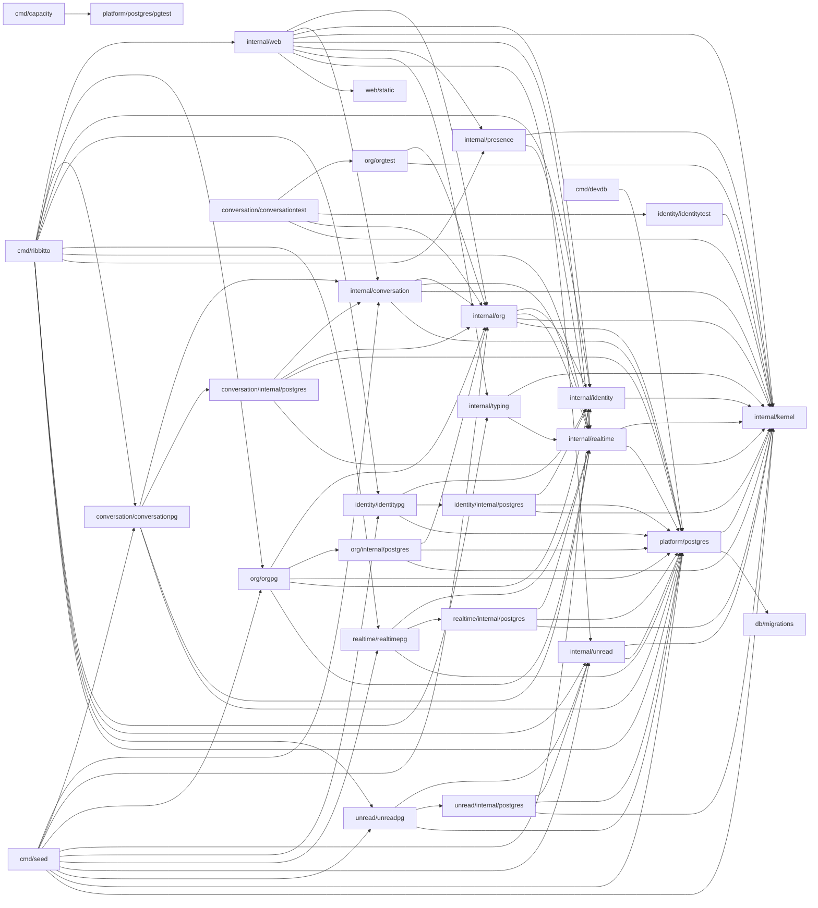

# Packages and allowed imports

Package responsibilities and allowed imports. See the [feature map](features.md)
and [architecture index](README.md).

**Keep current:** update this file with responsibility or import changes.

`cmd/ribbitto` is the server composition root: it reads configuration,
builds the concrete implementations and wires them together. `cmd/seed` is
a second, development-only composition root: it wires PostgreSQL stores
into setup, sign-up, authorization, channel, posting and topic branching
use cases to create [synthetic conversations](../seed-data.md), and into sessions,
authorization and history reads for a load run's expected messages. It never
imports `db/migrations`; the database must already be migrated.
`cmd/loadgen` is a development-only HTTP client and run-file comparator; it imports no application
packages. See [load client](load-client.md) for limits and usage.
`cmd/devdb` configures worktree databases and observes capacity through
`bin/ai-db --observe` for `cmd/capacity`. It imports
`internal/platform/postgres` for migrations; its tests use
`internal/platform/postgres/pgtest` for the admin URL rule. Credentials stay in
the environment.
`cmd/capacity` runs two uncached required-DB checks and cleans up their sessions.
It imports only `internal/platform/postgres/pgtest` for `pgtest.MaxConns`
and the tests' admin URL rule; it does not configure pools.
`cmd/dev` supervises the Tailwind and templ watchers in separate sessions,
including templ's server in another process group, and confirms descendant
cleanup on shutdown. It imports no application packages; `bin/ai-db run`
applies worktree configuration to templ and its server.
`cmd/argonreview` imports no application packages. `verify` requires a clean
`origin/main` build; `prepare` configures a dedicated `HOME`; `check` lists
models under a supervisor. `prompt` prints a PR review prompt; `review`
runs it; `issue` reviews issues; `copilot-check` checks Copilot follow-ups;
`probe` runs on scratch repositories; `guard` is the tool hook. A failed or
non-counting Copilot check falls back to the AI that did not write the
change: Codex for Claude's, Claude for Codex's ([workflow](../workflow/copilot.md)).

`tools/download` is a tools-module command that owns the Tailwind and
golangci-lint release pins, selects macOS arm64 or Linux amd64 assets, checks
SHA-256 hashes and installs binaries atomically. It imports only the standard
library; Make asks it for the versioned paths and invokes it on first use.

| Package | Responsibility | May import from this module |
|---|---|---|
| `internal/kernel` | What every module shares and none owns ([decision 26](../decisions/26-modules-by-feature-layout-seams-and-order.md)): `ID` only today. | nothing |
| `internal/platform/postgres` | The pool, the migration connection and runner, statement counting for development metrics, test databases (`pgtest`, which also migrates one to a version), and the opaque `Tx` and `Snapshot` with `InTx`, `InTxDetachedCommit` (a commit bounded by its own limit, not the request) and `InSnapshot`. No feature queries. Its `pgxbridge` unwraps a handle to pgx, for stores only. | `kernel`, `db/migrations` |
| `internal/identity` | The `identity` module's root: accounts, the email, password and display-name rules, password hashing, sessions, signing in and the display-name directory. Its store, `internal/identity/internal/postgres`, runs `db/queries/identity/` on its own `sqlcgen`; its wiring, `identitypg`, builds sessions, sign-in, the snapshot-bound directory (`AccountsIn`) and the transaction-bound account creator (`AccountCreatorIn`). Named functions in the composition roots and web's tests adapt the creator to org's factory and prove that it fits `org.AccountCreator`. See [`docs/api/identity.txt`](../api/identity.txt) for identifiers. | [manifest](../../module_imports_test.go) |
| `internal/realtime` | The `realtime` module's root, real-time delivery (M3): the hub's latest sequences, ephemeral generations and connection registry with process and per-account caps, the per-connection delivery loop, shared reads, the watermark check and event retention; presence and typing delivery are implemented. Declares the durable event types. Receives authorization, rendering and org's cursor bounds as interfaces it defines itself. Its store, `internal/realtime/internal/postgres`, reads, appends and expires `event_log` on its own `sqlcgen` (`db/queries/realtime/`), with org's retention lock and boundary injected (`RetentionBoundary`); its wiring, `realtimepg`, builds the reader and the cleaner (`NewCleaner`) and binds the appender to a writer's transaction (`AppenderIn`). See [`docs/api/realtime.txt`](../api/realtime.txt) for identifiers. | [manifest](../../module_imports_test.go) |
| `internal/org` | The `org` module: organisations, memberships, the **only** authorization logic, name/slug/handle rules and handle changes, member directory/search, `member.joined`, event sequence and cursor/retention bounds, transaction-owning setup and sign-up. Its store, `internal/org/internal/postgres`, runs `db/queries/org/` on its own `sqlcgen`; its wiring, `orgpg`, builds use cases and binds stores to callers' transactions or snapshots. See [`docs/api/org.txt`](../api/org.txt) for identifiers. `orgpg.EventCursorInTx` serves unread's feed transaction. `orgpg.SequenceIn` serves conversation's posting, branching and pinning transactions; `MembersIn` and `EventCursorIn` serve its snapshot. | [manifest](../../module_imports_test.go) |
| `internal/conversation` | The `conversation` module: channels, topics and messages with rules and errors, the membership-scoped topic lookup, channel creation, posting, branching and pinning owning their transactions, history and the page snapshot owning its snapshot, and the `message.posted`, `messages.moved` and `pins.changed` kinds it publishes. Owns `channel`, `topic` and `message`. Its store, `internal/conversation/internal/postgres`, runs `db/queries/conversation/` on its own `sqlcgen`; its wiring, `conversationpg`, builds use cases, binds stores to callers' transactions or snapshots and registers its routers. See [`docs/api/conversation.txt`](../api/conversation.txt) for identifiers. `conversationpg.DefaultChannelCreatorIn` serves setup's transaction; `MessageSequencesIn` serves unread's feed transaction. | [manifest](../../module_imports_test.go) |
| `internal/presence` | Memory-only online state, last-close grace expiry and bounded snapshots and ordered changes with a process/generation token and reset boundary. Constructed directly; web renders snapshots and live changes (#768). See [API](../api/presence.txt). | `kernel`, `realtime` (generation notifications) |
| `internal/typing` | Memory-only channel/topic summaries, explicit starts/stops and bounded viewer-filtered reads ([contract](typing.md), [API](../api/typing.txt)); channel-stream lifetime, owner expiry, composer generations, web signals and delivery to stable page status regions are implemented. | `kernel`, `realtime` (generation notifications) |
| `internal/unread` | Owns read state (decision 32). Its store locks a member/channel row, inserts the join prefix and unions a range with primary-key-bounded neighbours in the caller's transaction; `unreadpg.WriterIn` binds it. `unread.Reading` owns feed and topic transactions through an injected runner. The feed uses injected transaction-bound factories for conversation's message bounds and org's cursor; its store never reads messages. See [API](../api/unread.txt). | [manifest](../../module_imports_test.go) |
| `internal/web` | HTTP routing, handlers, middleware, templ components (`internal/web/view`), the SSE endpoints. The only package that produces HTML. | `kernel`, `identity`, `org`, `conversation`, `realtime`, `presence`, `typing`, `unread`, `web/static` |
| `db/migrations` | Embedded goose SQL migrations. | — |
| `web/static` | Embedded CSS, application JavaScript, vendored JavaScript, SVG icons, brand images and channel illustrations. | — |

A package's sub-packages may import each other, apart from the store,
wiring and fixture rules. [Modules](modules.md) states the test-only
fixture rule. The [module manifest and Go tests](../../module_imports_test.go)
check module imports; depguard retains the other boundaries;
[import checks](import-checks.md) lists those rules, fixture enforcement
and the `doc.go` requirement.

The diagram illustrates selected dependencies; the [manifest](../../module_imports_test.go) governs module imports; [`docs/dependencies.md`](../dependencies.md) lists the actual ones.

Why this shape: the domain and the use cases stay testable without a
database or HTTP; authorization lives in exactly one place, so a new
endpoint or a real-time path cannot quietly skip it; and because use cases
return plain structs and only `web` renders HTML, a JSON API can be added
next to the HTML handlers later without touching the use cases.

`serve` uses a `pgxpool.Pool` ([timeouts](../recount-capacity.md)); `migrate`
uses goose's `database/sql` handle.
