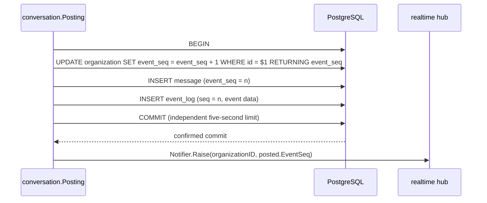

# Posting a message

HTTP sends first pass [member admission](member-admission.md), including keyed retries.
Durable events and the event log they are written to: [real time](realtime.md#durable-event-log).

`conversation.Posting.Send` validates and owns the transaction through
its `TxRunner` (`PostToTopic` and `Post` delegate to it): its transaction-bound `EventSequence` takes the sequence, then
its `Writer` reads the default topic (and the selected topic, if supplied)
and inserts the message; `Post` is its shorthand for the default topic. It
encodes the post with `conversation.EncodePosted` and calls its
transaction-bound `EventAppender.Append` before commit. `Send` with a cursor also
reads the composer's scope and own message through `PostReadWriterIn` in that
transaction, under org-first locking ([unread writes](unread-writes.md)).
Org's sequence (`orgpg.SequenceIn`) and realtime's appender
(`realtimepg.AppenderIn`) use that same transaction and sequence.
`conversation.NewPosting` accepts `conversation.Notifier`
(`Raise(organizationID kernel.ID, seq int64)`); a nil notifier disables
notifications. `Post` calls it only after the runner commits; `serve` wires
`realtime.Hub` to it. A channel outside the caller's organisation fails the
scoped topic lookup and rolls the sequence back with it. Composite foreign
keys also enforce the message's organisation scope.

The shared `conversationpg` runner uses `platform.InTxDetachedCommit` for
posting, branching, pinning and channel creation. Work follows the request;
only COMMIT and ROLLBACK ignore its cancellation, each bounded by five seconds.
Posting, branching and pinning return success and raise on a confirmed commit
even after request cancellation.
`platform.ErrCommitUnknown` returns an error without raising: a rollback can
leave sequence N available for the next commit, whose raise must still wake
streams at N−1. The watermark tick catches up any unconfirmed commit that did
succeed. Retrying with the same idempotency key deduplicates a committed post
through the repeated-send path below.

- **Take the sequence number first.** The `UPDATE` (scoped to the
  organisation from the URL, `WHERE id = $1`) locks that organisation's row
  until commit, so sequence order equals commit order and no gap can be
  skipped by a reader. A rolled-back transaction also rolls back the
  increment: no holes. The value is needed for `message.event_seq`, hence
  first.
- **The cost** is that durable events of one organisation are serialised on
  that row. Keep these transactions short and always lock the organisation
  first.
- **One sequence, two uses:** the same value goes into `event_log.seq`
  (real-time ordering and replay) and `message.event_seq` (unread counts), so
  unread state still works after old `event_log` rows are deleted.
- **Only durable events go into `event_log`.** Typing indicators and presence
  are ephemeral and never replayed.
- **The hub is told the new sequence after commit.** It keeps, per
  organisation, the highest committed sequence it has seen — a *value*, not
  a one-shot signal (see [*No lost wakeups*](replay.md#ordering-and-replay)) — and only ever raises it.
  Events themselves are always read from `event_log`. A crash between
  commit and telling the hub loses nothing: readers catch up from the table.
  *Future work:* with more than one server, the value would travel as PostgreSQL `NOTIFY`
  (payload: organisation and sequence) sent inside the writing transaction;
  each listener would raise its local hub's value, and after reconnecting
  read `organization.event_seq` and raise the value to that (#236).

**Member references** ([decision 39](../decisions/39-message-bodies-use-a-small-frozen-markup.md#member-references)).
`Send` scans typed `@handle` tokens once in the parser's eligible source
runs, including bold/italic delimiters, with their source positions
([names](../domain/names.md#typed-mentions)).
It lists the membership organisation's members once through
`ListSearchMembers`, using org's existing handle-ordered query and matching
in Go; without a candidate it never lists. Unknown, foreign and reserved
handles stay literal. Conversion stores only member IDs; the converted body
passes `ValidateMessageBody` again before writing, so expansion past 4,000
code points answers 422 `ErrInvalidBody` with the length message and draft kept.
`Send` parses the result as `chat_v1` and, if it holds references,
looks them all up in one batch through org's directory
(`LookupMembers`, scoped to the membership's organisation) in a snapshot of
its own, before the transaction, so the organisation lock never waits on it.
A reference the directory does not return, missing or another
organisation's, is `ErrUnknownReference` (wrapping `ErrInvalidBody`): web
answers 422 with one message and keeps the draft. A member who leaves
between the check and the insert shows as the placeholder, like any later
leaver. Handle listing and reference checking use separate snapshots. A member
who leaves between them makes the typed handle answer 422 like any unknown
reference. `NewPagePosting` takes the directory; posting without one (seeding
and tests) refuses references and handle candidates as a server error. The store inserts
`format = 'chat_v1'` for posts and branching's notices; branching escapes
its notice (`EscapeChatV1`), so a topic name is never markup or a reference.

**Quotes** ([decision 38](../decisions/38-a-quote-is-a-snapshot-owned-by-the-quoting-message.md)).
`Send.Quote` names a message to quote whole. Before the transaction, `Send`
reads it through conversation's `ReadStore` (`GetMessages`, scoped to the
membership's organisation and the posting channel) in a snapshot of its own,
with the members a `chat_v1` original references, so the organisation lock
never waits on the directory. In the transaction, after the topic and under
the organisation lock that moves take too, `Writer.QuotedMessage` reads it
again with the same scope; only that read decides. The snapshot is the original's
own text, never its quote: `Entry.Text` with references as `@handle` or
`Send.UnknownMember`, trimmed by `ValidateMessageBody`, which refuses an
empty one as `ErrInvalidBody`. Missing, another organisation's and another
channel's originals are one `ErrQuoteNotFound` (web: 404), which rolls back
the sequence; so does an original deleted before the insert, through
`message_quoted_message_fkey`. A repeat compares the quote too.

**Repeated sends** ([decision 37](../decisions/37-composer-javascript-pending-posts-keys-and-drafts.md#b-idempotency-key-1155)).
Web posts through `conversation.Posting.Send`, which takes the optional
cursor and the composer's `IdempotencyKey`; `PostToTopic` and `Post`
delegate to it. Only a keyed body with a valid handle candidate and an available
member directory gets a scoped preflight key lookup using the same tokens
in a separate read transaction, before conversion, expansion or reference checks.
A found message resolves the requested composer topic without taking a sequence.
Ordinary keyed posts retain the insert-first path. The insert stores the key
and `typed_body_proof` of the normalized typed input atomically with the converted
body, and the partial unique index `message_idempotency_key_idx` on
(organisation, author, key) still decides concurrent sends. Its `23505` becomes `ErrPostKeyTaken`, which rolls back
the transaction with its `event_seq` increment (no holes). `Send` then reads
the stored message by the membership's organisation, author and key in a
short transaction of its own (`Writer.KeyedMessage`) and returns it with no
event and no notification. The organisation lock serialises two sends with
one key, so the second always sees the first's row. A repeat compares the
whole normalized typed body by its stored proof
(4-byte big-endian byte length and SHA-256 digest). For legacy rows without a
proof, only an exact stored-body match with no member reference is equal
(`plain_text`, or `chat_v1` with none). A prefix is never a whole-body retry.
The proof compares typed input independently of the converted body, so a rename
or handle reassignment cannot retarget a retry.
A repeat whose typed body, quote or channel differs returns
`ErrPostKeyReused` with the stored message:
it is not a retry, and its text must not be dropped. The topic is not
compared, because branching may have moved the message. `Sent.Topic` is the
place resolved for the request; a repeat's composer and typing stay there. An unquoted enhanced 409 in the same channel can recover only the
new request's prefix verified by `Message.TypedBodyPrefix`: its first stored-length
bytes must hash to the stored digest. Only that typed prefix is offered as
`data-sent-body`; missing proof or a mismatch keeps the error and draft.

The channel page reads its channel, sidebar, history and both author batches
in one `REPEATABLE READ READ ONLY` transaction owned by `conversation.Reader`
through its `SnapshotRunner`, wired by `conversationpg.NewReader`.
Every history page also reads `organization.event_seq` in that snapshot. The
page renders it as `data-event-cursor` on `#organization-stream`, outside every
htmx swap, including `?before=` pages. Loading older history or replacing the
composer leaves the initial page cursor intact.
`conversation.Reader.One` uses the same snapshot pattern for an event's
organisation, channel and `event_seq`, returning the message with current
author names or `conversation.ErrMessageNotFound`.

