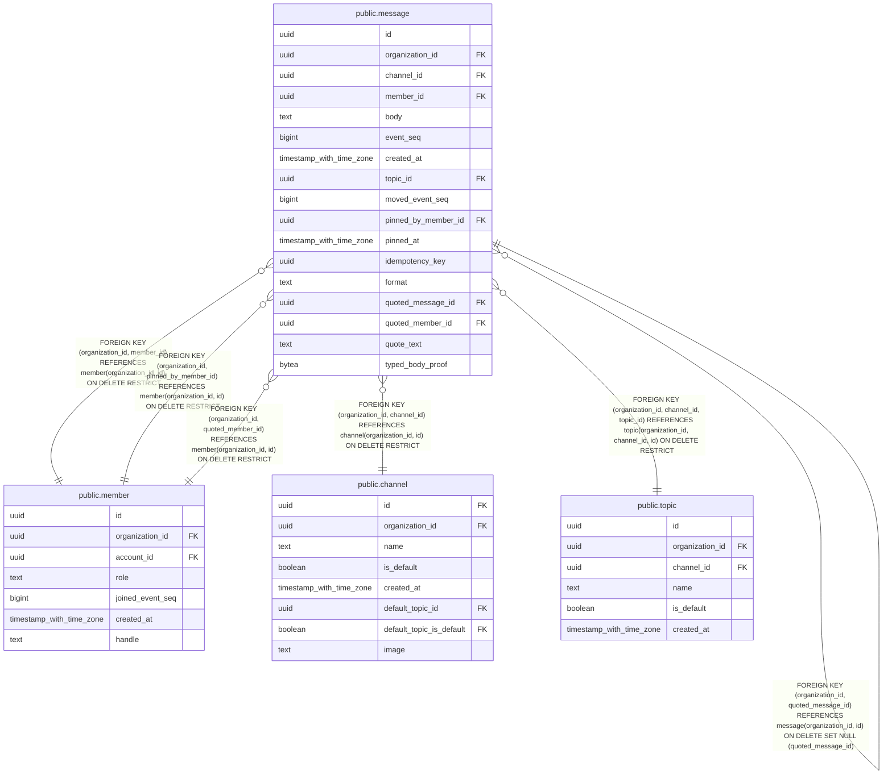

# public.message

## Columns

| Name | Type | Default | Nullable | Children | Parents | Comment |
| ---- | ---- | ------- | -------- | -------- | ------- | ------- |
| id | uuid | uuidv7() | false | [public.message](public.message.md) |  |  |
| organization_id | uuid |  | false | [public.message](public.message.md) | [public.member](public.member.md) [public.channel](public.channel.md) [public.topic](public.topic.md) [public.message](public.message.md) |  |
| channel_id | uuid |  | false |  | [public.channel](public.channel.md) [public.topic](public.topic.md) |  |
| member_id | uuid |  | false |  | [public.member](public.member.md) |  |
| body | text |  | false |  |  |  |
| event_seq | bigint |  | false |  |  |  |
| created_at | timestamp with time zone | now() | false |  |  |  |
| topic_id | uuid |  | false |  | [public.topic](public.topic.md) |  |
| moved_event_seq | bigint |  | true |  |  |  |
| pinned_by_member_id | uuid |  | true |  | [public.member](public.member.md) |  |
| pinned_at | timestamp with time zone |  | true |  |  |  |
| idempotency_key | uuid |  | true |  |  |  |
| format | text | 'plain_text'::text | false |  |  |  |
| quoted_message_id | uuid |  | true |  | [public.message](public.message.md) |  |
| quoted_member_id | uuid |  | true |  | [public.member](public.member.md) |  |
| quote_text | text |  | true |  |  |  |
| typed_body_proof | bytea |  | true |  |  |  |

## Constraints

| Name | Type | Definition |
| ---- | ---- | ---------- |
| message_body_check | CHECK | CHECK (((length(body) >= 1) AND (length(body) <= 4000))) |
| message_body_check1 | CHECK | CHECK ((body !~ '[---Ÿ

‪‫‬‭‮]'::text)) |
| message_body_check2 | CHECK | CHECK ((body = btrim(body, '	   '::text))) |
| message_body_not_null | n | NOT NULL body |
| message_channel_id_not_null | n | NOT NULL channel_id |
| message_created_at_not_null | n | NOT NULL created_at |
| message_event_seq_check | CHECK | CHECK ((event_seq >= 1)) |
| message_event_seq_not_null | n | NOT NULL event_seq |
| message_format_check | CHECK | CHECK ((format = ANY (ARRAY['plain_text'::text, 'chat_v1'::text]))) |
| message_format_not_null | n | NOT NULL format |
| message_id_not_null | n | NOT NULL id |
| message_member_id_not_null | n | NOT NULL member_id |
| message_organization_id_not_null | n | NOT NULL organization_id |
| message_pin_pair_check | CHECK | CHECK (((pinned_by_member_id IS NULL) = (pinned_at IS NULL))) |
| message_quote_check | CHECK | CHECK ((((quoted_member_id IS NULL) = (quote_text IS NULL)) AND ((quoted_message_id IS NULL) OR (quoted_member_id IS NOT NULL)))) |
| message_quote_text_characters_check | CHECK | CHECK ((quote_text !~ '[---Ÿ

‪‫‬‭‮]'::text)) |
| message_quote_text_length_check | CHECK | CHECK (((length(quote_text) >= 1) AND (length(quote_text) <= 4000))) |
| message_quote_text_trim_check | CHECK | CHECK ((quote_text = btrim(quote_text, '	   '::text))) |
| message_topic_id_not_null | n | NOT NULL topic_id |
| message_typed_body_proof_check | CHECK | CHECK (((typed_body_proof IS NULL) OR (octet_length(typed_body_proof) = 36))) |
| message_organization_id_member_id_fkey | FOREIGN KEY | FOREIGN KEY (organization_id, member_id) REFERENCES member(organization_id, id) ON DELETE RESTRICT |
| message_pinner_fkey | FOREIGN KEY | FOREIGN KEY (organization_id, pinned_by_member_id) REFERENCES member(organization_id, id) ON DELETE RESTRICT |
| message_quoted_member_fkey | FOREIGN KEY | FOREIGN KEY (organization_id, quoted_member_id) REFERENCES member(organization_id, id) ON DELETE RESTRICT |
| message_organization_id_channel_id_fkey | FOREIGN KEY | FOREIGN KEY (organization_id, channel_id) REFERENCES channel(organization_id, id) ON DELETE RESTRICT |
| message_pkey | PRIMARY KEY | PRIMARY KEY (id) |
| message_organization_id_event_seq_key | UNIQUE | UNIQUE (organization_id, event_seq) |
| message_topic_fkey | FOREIGN KEY | FOREIGN KEY (organization_id, channel_id, topic_id) REFERENCES topic(organization_id, channel_id, id) ON DELETE RESTRICT |
| message_organization_id_id_key | UNIQUE | UNIQUE (organization_id, id) |
| message_quoted_message_fkey | FOREIGN KEY | FOREIGN KEY (organization_id, quoted_message_id) REFERENCES message(organization_id, id) ON DELETE SET NULL (quoted_message_id) |

## Indexes

| Name | Definition |
| ---- | ---------- |
| message_pkey | CREATE UNIQUE INDEX message_pkey ON public.message USING btree (id) |
| message_organization_id_event_seq_key | CREATE UNIQUE INDEX message_organization_id_event_seq_key ON public.message USING btree (organization_id, event_seq) |
| message_channel_event_seq_idx | CREATE INDEX message_channel_event_seq_idx ON public.message USING btree (organization_id, channel_id, event_seq) |
| message_topic_event_seq_idx | CREATE INDEX message_topic_event_seq_idx ON public.message USING btree (organization_id, topic_id, event_seq) |
| message_moved_event_seq_idx | CREATE INDEX message_moved_event_seq_idx ON public.message USING btree (organization_id, topic_id, moved_event_seq) WHERE (moved_event_seq IS NOT NULL) |
| message_channel_pin_idx | CREATE INDEX message_channel_pin_idx ON public.message USING btree (organization_id, channel_id, pinned_at DESC, id) WHERE (pinned_at IS NOT NULL) |
| message_idempotency_key_idx | CREATE UNIQUE INDEX message_idempotency_key_idx ON public.message USING btree (organization_id, member_id, idempotency_key) WHERE (idempotency_key IS NOT NULL) |
| message_organization_id_id_key | CREATE UNIQUE INDEX message_organization_id_id_key ON public.message USING btree (organization_id, id) |
| message_quoted_message_idx | CREATE INDEX message_quoted_message_idx ON public.message USING btree (organization_id, quoted_message_id) WHERE (quoted_message_id IS NOT NULL) |

## Relations

---

> Generated by [tbls](https://github.com/k1LoW/tbls)
