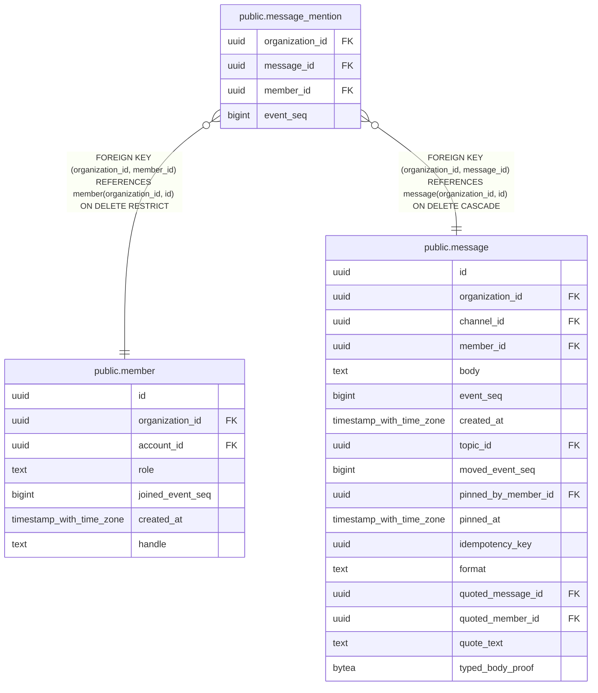

# public.message_mention

## Columns

| Name | Type | Default | Nullable | Children | Parents | Comment |
| ---- | ---- | ------- | -------- | -------- | ------- | ------- |
| organization_id | uuid |  | false |  | [public.member](public.member.md) [public.message](public.message.md) |  |
| message_id | uuid |  | false |  | [public.message](public.message.md) |  |
| member_id | uuid |  | false |  | [public.member](public.member.md) |  |
| event_seq | bigint |  | false |  |  |  |

## Constraints

| Name | Type | Definition |
| ---- | ---- | ---------- |
| message_mention_event_seq_check | CHECK | CHECK ((event_seq >= 1)) |
| message_mention_event_seq_not_null | n | NOT NULL event_seq |
| message_mention_member_id_not_null | n | NOT NULL member_id |
| message_mention_message_id_not_null | n | NOT NULL message_id |
| message_mention_organization_id_not_null | n | NOT NULL organization_id |
| message_mention_member_fkey | FOREIGN KEY | FOREIGN KEY (organization_id, member_id) REFERENCES member(organization_id, id) ON DELETE RESTRICT |
| message_mention_message_fkey | FOREIGN KEY | FOREIGN KEY (organization_id, message_id) REFERENCES message(organization_id, id) ON DELETE CASCADE |
| message_mention_pkey | PRIMARY KEY | PRIMARY KEY (organization_id, message_id, member_id) |

## Indexes

| Name | Definition |
| ---- | ---------- |
| message_mention_pkey | CREATE UNIQUE INDEX message_mention_pkey ON public.message_mention USING btree (organization_id, message_id, member_id) |
| message_mention_member_event_seq_idx | CREATE INDEX message_mention_member_event_seq_idx ON public.message_mention USING btree (organization_id, member_id, event_seq DESC) |

## Relations

---

> Generated by [tbls](https://github.com/k1LoW/tbls)
